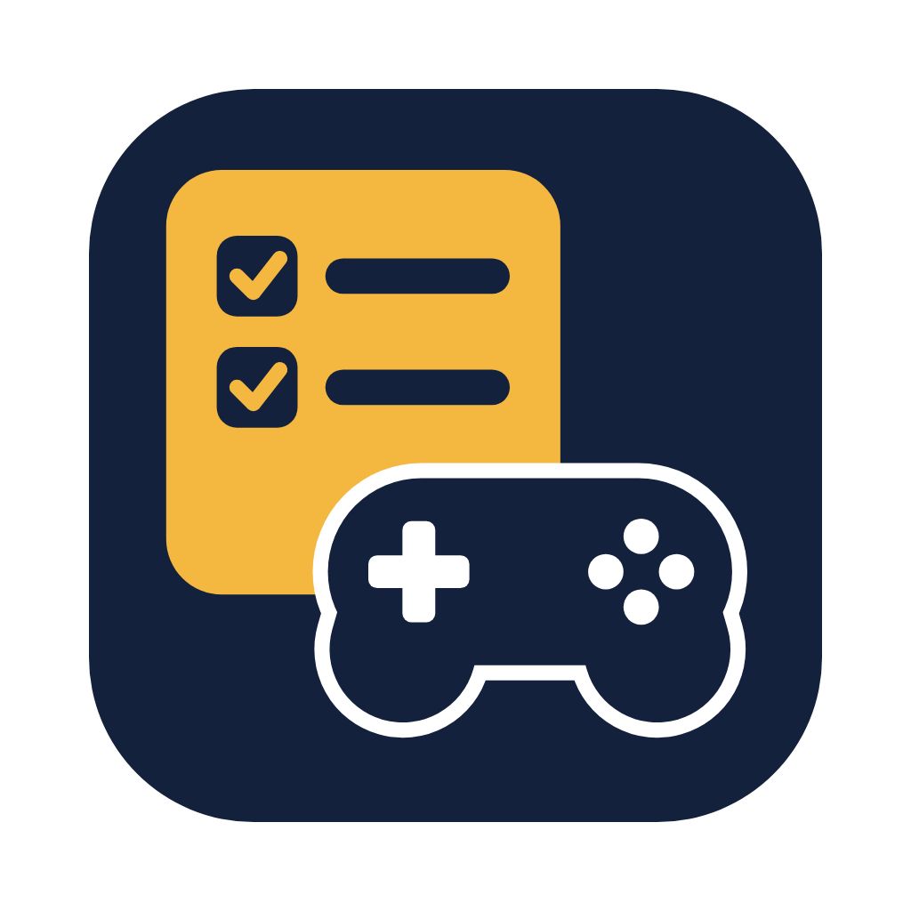
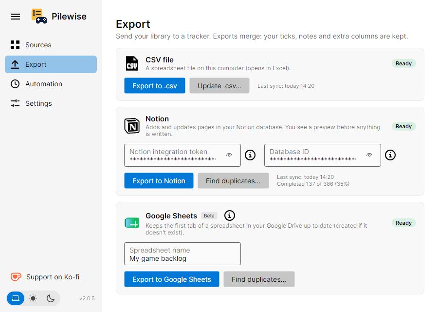
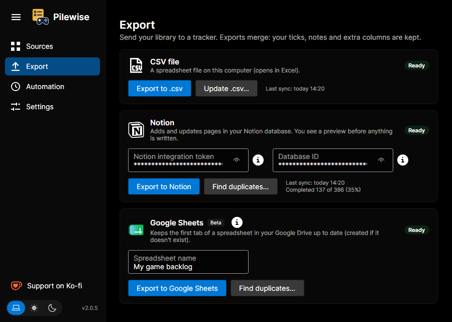
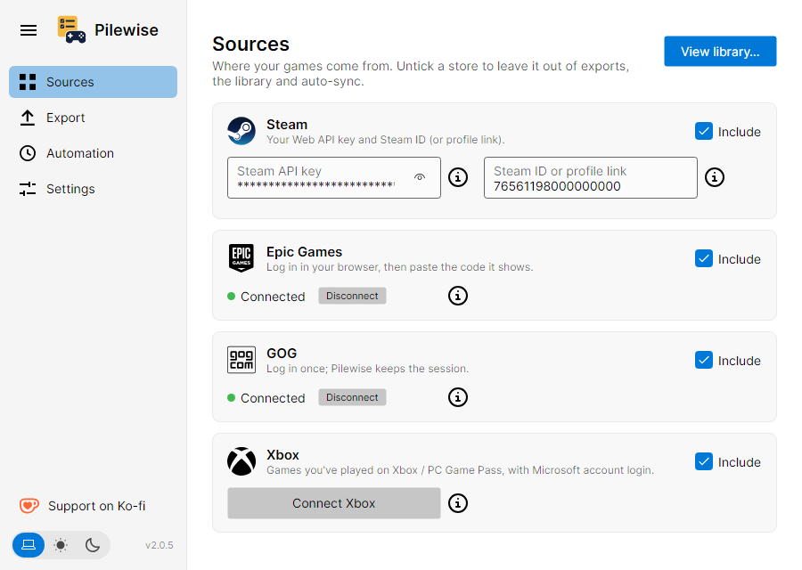
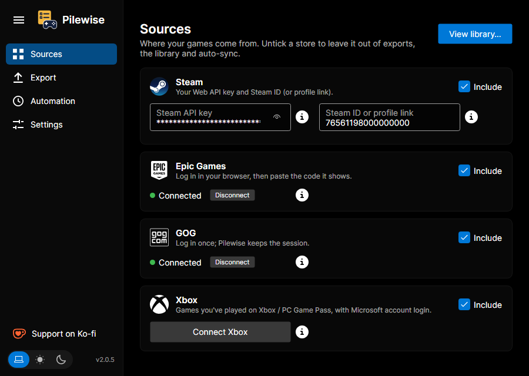
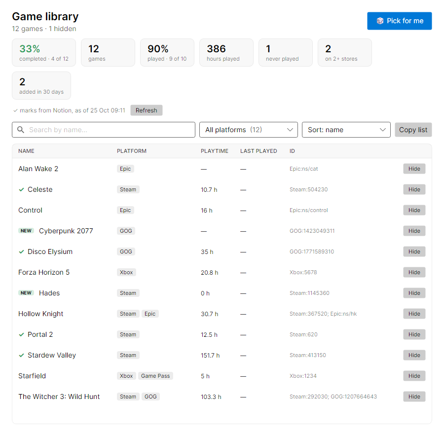
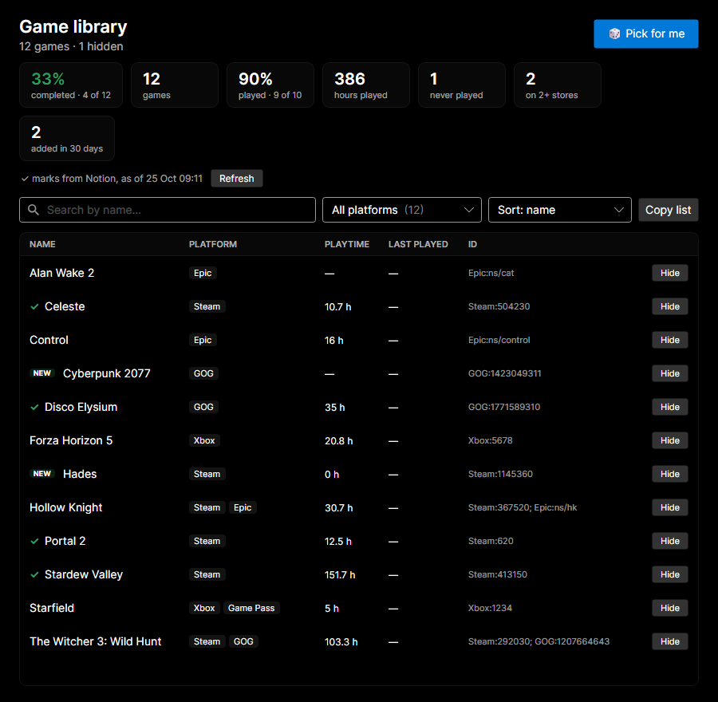
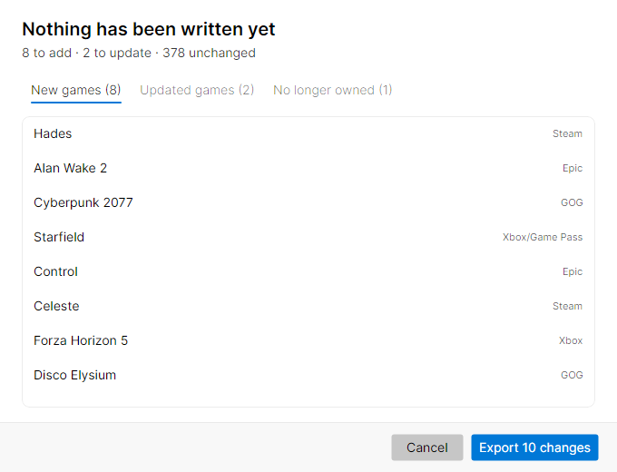
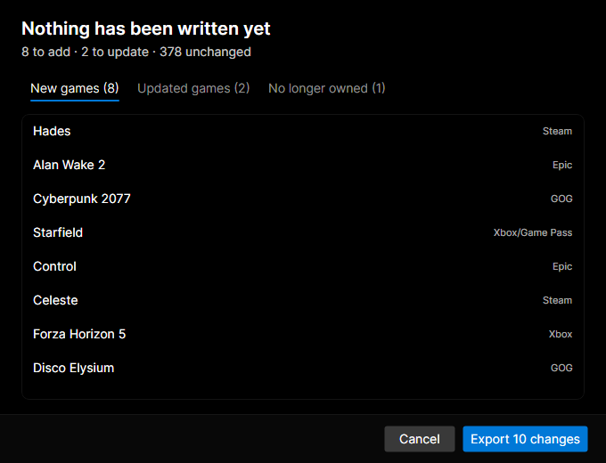

<div align="center">



# Pilewise

**Your whole game library, in one backlog.**

Pull your owned games from **Steam, Epic, GOG and Xbox** and sync them into **Notion**,
**Google Sheets** or a local **CSV**, so you can see what you've completed, what's in
progress, and what you never even started.

[](https://github.com/AleksandrPidlozhevich/Pilewise/releases)
[](#download)
[](https://dotnet.microsoft.com/)
[](https://avaloniaui.net/)
[](#privacy)
[](LICENSE.txt)

[**Download**](#download) · [**Features**](#features) · [**Connect stores**](#connecting-your-stores) · [**Export**](#export-targets) · [**Privacy**](#privacy)

</div>

<br>

<div align="center">

| Light | Dark |
| :---: | :---: |
|  |  |

</div>

---

## Screenshots

<div align="center">

| Light | Dark |
| :---: | :---: |
|  |  |
| **Sources**: Steam, Epic, GOG and Xbox in one place | |
|  |  |
| **Library viewer**: search, filters, playtime, backlog progress, Pick for me | |
|  |  |
| **Preview before Notion**: see every change before it's written | |
|  |  |
| **Automation**: scheduled sync, tray and start at login | |

</div>

---

## Why Pilewise?

You buy games during sales, and then you forget what you already own and where you bought it.
Pilewise collects every library into **one merged list** and keeps your tracker up to date. A
game you own on two stores becomes one row, tagged with both platforms.

---

## Download

<div align="center">

[](https://github.com/AleksandrPidlozhevich/Pilewise/releases)
[](https://github.com/AleksandrPidlozhevich/Pilewise/releases)
[](https://github.com/AleksandrPidlozhevich/Pilewise/releases)

</div>

From the [latest release](https://github.com/AleksandrPidlozhevich/Pilewise/releases/latest), pick
the file for your system:

| System | File |
| :--- | :--- |
| Windows | `Pilewise-win-x64-Setup.exe` (per-user installer), `Pilewise-win-x64.msi` (Windows Installer, per-user or per-machine), or `Pilewise-win-x64-Portable.zip` |
| macOS (Apple Silicon, M1 and later) | `Pilewise-osx-arm64.dmg` (drag to Applications) or `Pilewise-osx-arm64-Portable.zip` |
| macOS (Intel) | `Pilewise-osx-x64.dmg` (drag to Applications) or `Pilewise-osx-x64-Portable.zip` |
| Linux | `Pilewise-linux-x64.AppImage` |

The macOS app is signed with a Developer ID and notarized by Apple, so it opens without Gatekeeper
warnings.

> [!TIP]
> **Pilewise updates itself.** When a new version is out, a banner appears at the top of the
> window. Click **Update & restart** and you're done.

---

## Features

| | |
| --- | --- |
| 🎮 **Four stores, one list** | Pulls the games you own on Steam, Epic, GOG and Xbox and merges copies of the same game. Untick a store to leave it out of exports. |
| 📤 **Three export targets** | A Notion database, Google Sheets, or a local CSV file. |
| 📚 **Library viewer** | Browse the merged library before exporting: search by name, filter by store, sort by playtime or last played, and spot games you **never played** or own on two stores. **Hide** demos, test servers or tools to leave them out of every export. The footer shows how much of the library you've played, your total hours, and your most-played game. Double-click a game to open its store page. |
| 🆕 **Recently added** | The library marks new games **NEW**, and you can filter or sort by *recently added*. Stores don't say when you bought a game, so this only covers games that appeared after you connected that store. |
| 🎲 **Pick for me** | Can't decide? The library viewer suggests a game from the list shown, skipping completed and hidden ones and preferring games you've barely touched. |
| ✅ **Backlog progress** | After an export to Notion or Google Sheets, that panel shows *Completed 120 of 640 (19%)*, and the library marks finished games with a ✓. Filter by **Completed** or **Not completed**. **Refresh** in the library updates the ✓ from Notion or Google Sheets without exporting again. |
| 📋 **Copy list** | Copies the games currently on screen, including whatever search and filters you've set. Paste into a spreadsheet and they land in columns. |
| ⬇️ **Updates** | A new version shows up in the sidebar and under *Settings → Updates* (**Check for updates**, **Download & restart**). If you leave the app open, it looks again every 12 hours. |
| 🖼️ **Covers & store links** | New Notion pages get the game's cover image and a `Store link`; existing pages without one are filled in. |
| 🧹 **Duplicate finder** | **Find duplicates…** spots Notion pages or Google Sheets rows of the same game and merges them (you confirm first; extra Notion pages go to the trash, extra sheet rows are deleted — Sheets' version history can bring them back). |
| ⌨️ **Shortcuts** | Ctrl+1–4 (⌘ on macOS) switch pages, Ctrl+L opens the library; in the library Ctrl+F searches and Esc clears the search or closes it. |
| 🗑️ **No longer owned** | Spots games in your tracker that left your library (refunds, delistings). They're never deleted. An optional `Owned` checkbox column gets unticked for them. |
| ⏰ **Scheduled sync** | **Auto-sync** keeps Notion, Google Sheets and your CSV up to date (hourly, every 6 hours or daily) while the app runs; with **Close to tray** and **Start at login** it keeps going in the background on Windows, macOS and Linux. `Pilewise --sync notion,sheets` syncs without opening the window, ready for Task Scheduler or cron. **History…** (also in the tray menu) lists every recent sync and its result. |
| ⏱️ **Playtime** | Optional `Playtime` and `Last played` columns in Notion and Google Sheets are filled from Steam (last played from Xbox too). |
| 🔁 **Incremental sync** | Run the export again and it matches what's already in your tracker. New games are added, platform tags are updated, and you don't get a second copy of a game. |
| 👀 **Preview before Notion** | See exactly which games will be added or updated, and confirm before anything is written. |
| 🪟 **Remembers the window** | Size, position and maximized state are restored on the next start. |
| 🖱️ **Drag & drop** | Drop a Pilewise `.csv` onto the window to update it with your current library, or a saved settings file to import it. |
| ⏹️ **Cancellable** | Every export shows a progress bar with a **Cancel** button. |
| 🔒 **Secure by default** | Store logins and saved credentials stay **encrypted** on your computer and refresh on their own. |
| 🌗 **Light & dark themes** | Switch with one click. |
| 💻 **Cross-platform** | One app for Windows, macOS and Linux. |

---

## Getting started

```
 1. Download  ──▶  2. Connect your stores  ──▶  3. Pick a target & export
```

1. **Download** and run the app for your OS (see [Download](#download)).
2. **Connect** at least one store (see [Connecting your stores](#connecting-your-stores)).
3. **Pick an export target** and run the export (see [Export targets](#export-targets)).

---

## Connecting your stores

| Store | How you connect | Login window |
| :--- | :--- | :--- |
|  **Steam** | Steam ID + Web API key | None. Fill in two fields. |
| <picture><source media="(prefers-color-scheme: dark)" srcset="Pilewise/Assets/epic-games-dark.svg"></picture> **Epic Games** | Authorization code | Your **system browser** |
| <picture><source media="(prefers-color-scheme: dark)" srcset="Pilewise/Assets/gog-com-dark.svg"></picture> **GOG** | Automatic | **Embedded** in the app |
| <picture><source media="(prefers-color-scheme: dark)" srcset="Pilewise/Assets/xbox-dark.svg"></picture> **Xbox** | Automatic | **Embedded** in the app |

> [!TIP]
> Once a store is connected, the login stays **encrypted** on your computer and renews
> on its own, so you don't sign in every time.

### Steam

Steam needs your **Steam ID** and a **Steam Web API key**. You don't log in through the app.

<details>
<summary><b>1. Find your Steam ID</b></summary>

<br>

The quickest way: **paste your Steam profile link** into the Steam ID field, e.g.
`https://steamcommunity.com/id/yourname` or `https://steamcommunity.com/profiles/7656119…`.
The custom name on its own (`yourname`) works too, and so does an id like `[U:1:…]` or `STEAM_0:…`.

Or look up the number:

In the Steam desktop app:

1. Click your **username** in the top-right corner.
2. Select **Account details** from the dropdown.
3. Below your display name you'll see your **Steam ID**, a long number (usually 17 digits).
4. Copy and save this number.

</details>

<details>
<summary><b>2. Get your Steam Web API key</b></summary>

<br>

1. Go to the [Steam Web API key page](https://steamcommunity.com/dev/apikey).
2. Sign in to your Steam account if prompted.
3. Accept the **Steam Web API Terms of Use**.
4. Enter a domain name (any name works, e.g. `pilewise-local`) and click **Register**.
5. Copy the **API key** shown on the page.

If the key page is confusing, [Steam's own write-up](https://developer.valvesoftware.com/wiki/Steam_Web_API) walks through it.

</details>

> [!WARNING]
> **Don't share your API key.** Leave it out of screenshots, chats and public posts. Anyone
> who has it can look through your Steam library. Your Steam ID is already visible in your
> profile link.

### Epic Games

Epic won't show its login inside the app (the page asks for a CAPTCHA), so you sign in in your **usual browser**:

1. Click **Connect** on the Epic card. Your default browser opens Epic's login page.
2. Sign in. Epic then shows a page with an **authorization code**.
3. Copy the code and paste it into the app. When possible, the app picks it up from the
   clipboard automatically.

### GOG

GOG opens its login inside the app:

1. Click **Connect** on the GOG card. A login window opens.
2. Sign in. When that's done, the window closes on its own.

### Xbox

Xbox opens its login inside the app too:

1. Click **Connect** on the Xbox card. A Microsoft login window opens.
2. Sign in with your Microsoft account. When that's done, the window closes on its own.
3. Game Pass games are marked when Xbox says they are. A few may be missed.

---

## Export targets

| Target | Needs | Best for |
| :--- | :--- | :--- |
| <picture><source media="(prefers-color-scheme: dark)" srcset="Pilewise/Assets/file-csv-dark.svg"></picture> **CSV** | Nothing | Excel, quick offline lists |
| <picture><source media="(prefers-color-scheme: dark)" srcset="Pilewise/Assets/notion-dark.svg"></picture> **Notion** | Integration token + database ID | A rich, filterable backlog tracker |
|  **Google Sheets** *(beta)* | A Google account | A shared spreadsheet |

### CSV

The simplest target. No account or token needed.

- **Export to CSV** writes the full merged library to a CSV file you pick.
- **Update CSV** merges the current library into an existing CSV. It keeps your completion
  status and doesn't create duplicates. The previous version is saved next to it as
  `<name>.csv.bak`. **Undo** in the result banner puts the old file back. If you've already
  closed that banner, delete the new CSV and rename the `.bak`.

The file is saved so Excel opens game names correctly.

### Notion

To sync into Notion you need a Notion **integration token**, a **database ID**, and a database
with the **right properties**.

<details>
<summary><b>1. Create an integration and get the token</b></summary>

<br>

1. Go to the [Notion integrations page](https://www.notion.so/profile/integrations).
2. Click **New integration**.
3. Fill in the name and select the workspace where the integration will be used.
4. Copy the **Internal Integration Token** (a long string starting with `ntn_...`).
5. Save this token somewhere safe. You'll need it in the app settings.

🛡️ Grant the integration these capabilities:

- ✅ `Read content`
- ✅ `Update content`
- ✅ `Insert content`

| | | |
| :---: | :---: | :---: |
|  |  |  |

</details>

<details>
<summary><b>2. Share the database with the integration</b></summary>

<br>

**Share the target Notion database** with the integration, the same way you'd share it with a
person. Otherwise the app can't see or write to it.

</details>

<details>
<summary><b>3. Find your database ID</b></summary>

<br>

1. Open your Notion workspace and go to the target database.
2. Look at the URL in your browser.
3. The **database ID** is the 32-character code after the last `/` and before `?`.


> [!NOTE]
> Paste that ID into the app. You don't need to look up a second ID anywhere else on the page.

</details>

<details>
<summary><b>4. Required database properties</b></summary>

<br>

The target database **must** have these properties (names are case-sensitive):

| Property | Type | What's in it |
| :--- | :--- | :--- |
| `Name` | Title | The game's title |
| `Platform's` | Multi-select | Stores you own it on (Steam, Epic, GOG, Xbox) |
| `GameID` | Text | Store and game id, for example `Steam:236870` or `Steam:236870; GOG:123` |
| `Store link` | URL | The game's store page. Filled only while empty, so a link you set yourself stays |

Each page also gets the game's **cover image** (Steam's header image; the GOG, Epic or Xbox art for
games not on Steam). A cover you set yourself is never replaced.

Optional: add any of these and Pilewise keeps them up to date too:

| Property | Type | What's in it |
| :--- | :--- | :--- |
| `Playtime` | Number | Hours played (Steam), e.g. `12.5` |
| `Last played` | Date | Date of the last session (Steam / Xbox) |
| `Owned` | Checkbox | Ticked while the game is in your library, unticked once it's gone |

A game is marked "no longer owned" only after Pilewise has checked every store listed on it.
If Epic or GOG asks you to sign in again, games from that store are left as they are.

**Backlog progress** comes from a column you maintain yourself. Pilewise never changes it.
Use a checkbox named `Completed`, `Done`, `Finished` or `Beaten`, or a `Status` field set to
`Done`, `Completed`, `Finished`, `Beaten` or `Played`. A dropdown (Select) with that name works too.


</details>

When you click **Export to Notion**, Pilewise first checks the database. If `Platform's`,
`GameID` or `Store link` is missing, it adds that column and says so in the preview. The first
export after an app update can also fill in covers and store links on pages that don't have
them yet, so that run may update a lot of pages. If the title column has the wrong name, or a
column has the wrong type, Pilewise tells you what to fix. Then it shows a **preview**: games
to add, and rows to update (before → after). Nothing is written until you click **Export**.

**Find duplicates…** looks for pages that are the same game: the same store id, or the same
title when the store ids match or one page has no store id yet. The oldest page is kept and
receives the stores and ids from the others. Those other pages go to Notion's trash, where
you can restore them for 30 days. Notes on the kept page stay as they are, so copy anything
you want off the extra pages first.

### Google Sheets (beta)

1. Enter a **table name** and click **Export to Google Sheets**. The first time, your browser
   opens so you can sign in to Google.
2. Pilewise finds the spreadsheet with that name in your Google Drive, or creates it, and opens it
   when the sync is done. It only asks for access to files it created itself (the `drive.file`
   permission), so a spreadsheet you made by hand isn't found: Pilewise creates a new one with
   that name instead. To keep using your own sheet, copy its contents into the one Pilewise made.

The first tab gets the same columns as the CSV, plus a checkbox to mark games as done:

| Platform | Name | ID | Completed |
| :--- | :--- | :--- | :---: |
| Steam/GOG | The Witcher 3 | Steam:292030; GOG:1207664643 | ☑ |

Want playtime too? Add a `Playtime`, `Last played` and/or `Owned` header to the first row (any free
column). Pilewise fills them with hours played (Steam), the date of the last session
(Steam / Xbox) and an ownership checkbox (unticked for games that left your library).
A `Store link` header gets the game's store page and a `Cover` header its cover image (an
`=IMAGE(…)` formula); both are filled only while the cell is empty, so your own values stay.

Re-running the export adds new games and updates platform tags in place. Your ticks, row order
and any extra columns you added are kept. Sheets created by older versions (Steam-only
`Name | Game ID | Completed`) are upgraded automatically.

**Find duplicates…** under the Google Sheets export looks for rows of the same game. For each, the
top row is kept and gets every store tag and id (plus the Completed tick, if any copy had it); the
other rows are deleted after you confirm. If the sheet changed since the search, nothing is
written. *File → Version history* in Google Sheets brings deleted rows back.

> [!CAUTION]
> Google Sheets support is still a **beta**. Signing in sometimes fails, and a few things
> may not work yet.

---

## Sync from the command line

Once you've connected your stores in the app, Pilewise can sync without opening the window,
for example on a schedule:

```
Pilewise --sync notion
Pilewise --sync notion,sheets --sheet "My games"
Pilewise --sync csv --file "D:\Games\backlog.csv"
Pilewise --sync notion,sheets --dry-run   # show what would change, write nothing
Pilewise --help
```

- It uses the stores, logins and Google Sheets name you already saved in the app. Those are
  saved when you start an export, and again when you close the window, so run the app once
  and export before you rely on the command.
- You can leave out `--file`. `--sync csv` then updates the CSV you last exported or updated.
- Notion is updated **without** the preview. Use `--dry-run` first if you want to see what
  would change.
- Every real run (not `--dry-run`) also shows up in **History…**.
- The result is printed in the terminal and written to the log. The command exits with `0`
  when it worked, `1` when a sync failed, and `2` when the arguments don't make sense.
- On Windows the app is at `%LocalAppData%\Pilewise\current\Pilewise.exe`. From PowerShell,
  start it with `Start-Process … -Wait -NoNewWindow` so the output stays in that window.
  From cmd, use `start /wait …`. Task Scheduler waits on its own, so the extra flags aren't needed there.

**Windows Task Scheduler**: *Create Basic Task* → trigger *Daily* → action *Start a program* →
program `%LocalAppData%\Pilewise\current\Pilewise.exe`, arguments `--sync notion`.

---

## Privacy

🔐 Pilewise does **not** collect, store or send any personal data to its developer. Logs and
cached credentials stay on your device, and credentials are encrypted. Google Sheets access is
limited to spreadsheets Pilewise created itself (`drive.file`).
See [PRIVACY_POLICY.md](PRIVACY_POLICY.md).

---

## Support the project

If Pilewise saved your backlog, you can buy me a coffee:

<a href="https://ko-fi.com/aliaksandrpidlazhevich"></a>

---

## Feedback and issues

Found a bug or have an idea? [Open an issue](https://github.com/AleksandrPidlozhevich/Pilewise/issues)
(the **Logs** link in the bottom-left corner of the app opens the log files to attach)
or write to **aleksandr.pidlozhevich@gmail.com**.

---

<div align="center">

Released under the [MIT License](LICENSE.txt) · Built with [.NET](https://dotnet.microsoft.com/) and [Avalonia UI](https://avaloniaui.net/)

</div>
